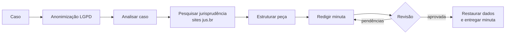

# ⚖️ Agente de Petições com IA — para escritórios de advocacia

> 🔒 **Software proprietário e pago.** Este repositório é uma **vitrine**: mostra o que o sistema faz e alguns trechos de código. O núcleo do agente é fechado e está disponível apenas para escritórios licenciados.

Agente em **Python + LangGraph** que apoia advogados na elaboração de petições: analisa o caso, **pesquisa jurisprudência nos sites oficiais dos tribunais**, monta o roteiro da peça, redige a minuta e faz uma revisão automática antes de entregar.

> ⚠️ **Ferramenta de apoio.** O resultado é sempre uma **minuta para revisão do advogado responsável**. O agente não substitui o advogado e não protocola nada.

---

## ✨ O que ele faz

| Etapa | O que acontece |
|---|---|
| 🔒 **Anonimização (LGPD)** | CPF, CNPJ, e-mail, telefone, nº de processo e nomes das partes são trocados por marcadores **antes** de qualquer envio ao modelo. Os dados reais só voltam na minuta final. |
| 🔎 **Análise do caso** | Identifica partes, fatos, teses, pedidos, competência, documentos necessários e **lacunas** de informação. |
| 📚 **Pesquisa de jurisprudência** | Busca **somente em domínios `jus.br`** — STF, STJ, TST, TSE, STM, TJs, TRFs, TRTs e TREs — e guarda o link de cada julgado. |
| 🗂️ **Roteiro da peça** | Estrutura conforme o CPC ou a CLT, indicando onde usar cada julgado. |
| ✍️ **Minuta** | Redige a peça completa em linguagem forense. |
| ✅ **Revisão automática** | Confere requisitos formais, coerência fatos × pedidos e citações. Se reprovar, a minuta é reescrita. |

### 🛡️ Proteção contra "jurisprudência inventada"

- Só cita julgados que a busca encontrou de fato, sempre com **link da fonte** e a marcação `[CONFERIR NO TRIBUNAL]`.
- Informação faltante vira `[PREENCHER: ...]` — o agente não inventa fatos.
- A revisão reprova minutas com julgados fora da lista pesquisada.

## 🏗️ Arquitetura

## 📂 O que está aberto e o que é fechado

| Parte | Situação |
|---|---|
| `agente_peticao/anonimizacao.py` — mascaramento LGPD | 👀 Aberto para demonstração |
| `agente_peticao/estado.py` — estrutura de dados do fluxo | 👀 Aberto para demonstração |
| Fluxo do agente (LangGraph), instruções do modelo, pesquisa de jurisprudência, revisão automática, geração das minutas | 🔒 **Fechado — somente licenciados** |

O código aberto aqui **não executa o sistema** sozinho. Ele está publicado só para mostrar a qualidade técnica do projeto.

## 💼 Como ter acesso

O sistema é **pago** e oferecido sob licença de uso para escritórios e advogados:

- 🔑 **Licença de uso** do sistema completo
- ⚙️ **Implantação** no escritório (modelo em nuvem ou **modelo local**, sem dados saindo do computador)
- 🧑‍💻 **Suporte e atualizações**
- 🎥 **Demonstração gratuita** antes da contratação

👉 **Solicite uma demonstração ou orçamento:** [LinkedIn — Marcos Vinícius Pimenta](https://www.linkedin.com/in/marcosvpimenta)

## ⚖️ Aviso legal

A responsabilidade técnica pelo conteúdo de qualquer peça é exclusivamente do advogado que a assina. Confira todos os julgados no site do tribunal de origem antes de utilizá-los.

## 👤 Autor

**Marcos Vinícius Pimenta** — Desenvolvedor Python | Agentes de IA | Bacharel em Direito e Ciências Contábeis

[LinkedIn](https://www.linkedin.com/in/marcosvpimenta) · [GitHub](https://github.com/Marcospimentaadv)

**© 2026 Marcos Vinícius Pimenta. Todos os direitos reservados.** Uso sujeito a licença comercial — veja [LICENSE](LICENSE).
